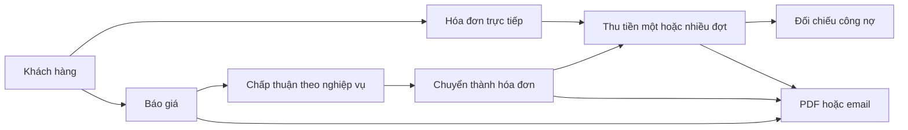

# Hướng dẫn sử dụng

Đối tượng: nhân viên kinh doanh, kế toán và quản trị viên.
Phụ trách: Maintainer sản phẩm. Trạng thái: nghiệp vụ hiện có, có giới hạn nêu bên dưới.
Phiên bản đối chiếu: `4.1.0`, baseline `d9187d0`. Rà soát: `2026-10-18`.

## Luồng làm việc



“Báo giá” tương ứng model `Quote`; giao diện có thể dùng nhãn hóa đơn tạm tính.
“Phiếu thu” tương ứng `Payment`. Phương thức thanh toán chỉ là danh mục ghi nhận cách thu tiền.
Ứng dụng không tự kết nối ngân hàng hoặc thực hiện thanh toán trực tuyến.

## Đăng nhập và cấu hình

1. Đăng nhập vào môi trường đã được người vận hành cung cấp.
2. Đổi mật khẩu khởi tạo nếu đây là môi trường local mới.
3. Khai báo doanh nghiệp, tiền tệ, logo, ngôn ngữ và định dạng tiền/ngày.
4. Kiểm tra thuế và phương thức thanh toán trước khi tạo chứng từ.

Địa chỉ email của khách hàng cần chính xác nếu sử dụng gửi chứng từ.
Trong môi trường thử nghiệm, dùng dữ liệu giả như `contact@example.test` và SMTP Mailpit.
Các mức thuế trong ví dụ chỉ minh họa cách tính, không phải cấu hình thuế áp dụng cho một doanh nghiệp.

## Khách hàng và báo giá

Tạo khách hàng với tên, email, số điện thoại, địa chỉ và quốc gia.
Chọn khách hàng khi lập báo giá, nhập ngày lập, ngày hết hiệu lực và các dòng dịch vụ/hàng hóa.
Mỗi dòng gồm tên, mô tả, số lượng và đơn giá. Nhập thuế suất và chiết khấu của chứng từ.

Kiểm tra bản PDF trước khi gửi. Theo dõi phản hồi của khách hàng bằng trạng thái nghiệp vụ phù hợp.
Trong quy trình sử dụng, chỉ chuyển báo giá đã được chấp thuận.
Controller hiện chưa bắt buộc trạng thái `accepted` hoặc chặn báo giá hết hạn khi chuyển.

Một báo giá chỉ được chuyển một lần; lần chuyển lại trả lỗi `409`.
Hóa đơn mới có trạng thái `draft`, số hóa đơn lấy từ bộ đếm và liên kết đến báo giá gốc.
Ngày hóa đơn là ngày chuyển, nhưng hạn thanh toán được sao chép từ `expiredDate` của báo giá.
Kiểm tra và sửa lại hạn thanh toán nếu không còn phù hợp.
Chuyển đổi chỉ đánh dấu `converted`, không tự biến mọi bước chấp thuận thành quy trình phê duyệt.

## Hóa đơn và số phải thu

Có thể lập hóa đơn trực tiếp mà không cần báo giá.
Backend tính lại tiền; không dùng tổng do trình duyệt gửi làm nguồn sự thật.

```text
Tiền dòng = số lượng × đơn giá
Tạm tính = tổng tiền các dòng
Tiền thuế = tạm tính × taxRate / 100
Tổng trước chiết khấu = tạm tính + tiền thuế
Phải thu = total − discount
Đã thu = tổng amount của phiếu thu còn hiệu lực
Còn phải thu = total − discount − credit
```

`discount` là số tiền, không phải tỷ lệ phần trăm.
Trong code hiện tại, thuế được tính trên tạm tính trước khi trừ chiết khấu.
Các phép tính dùng helper `currency.js` với độ chính xác mặc định hai chữ số thập phân.
Không sửa hóa đơn đã thu tiền mà chưa đối chiếu lại toàn bộ số dư.

Ví dụ tiền tệ USD:

| Thành phần | Số tiền |
| --- | ---: |
| Dòng 1: 2 × 100 | 200 |
| Dòng 2: 1 × 50 | 50 |
| Tạm tính | 250 |
| Thuế minh họa 8% | 20 |
| Total trước chiết khấu | 270 |
| Chiết khấu | 20 |
| Phải thu | 250 |

## Thu tiền nhiều đợt

1. Mở hóa đơn và kiểm tra số còn phải thu.
2. Tạo phiếu thu với số phiếu, ngày, số tiền, tiền tệ, phương thức và tham chiếu.
3. Đối chiếu kết quả cập nhật trước khi nhập đợt tiếp theo.

Với hóa đơn ví dụ, thu `100` làm trạng thái thành `partially`, còn `150`.
Thu tiếp `150` làm trạng thái thành `paid`, số dư bằng `0`.
Số tiền phải lớn hơn `0` và không được vượt số dư. Backend kiểm tra trong transaction.
Khi sửa/xóa phiếu thu, hệ thống tính lại credit và trạng thái của hóa đơn.

Sửa phiếu thu không chuyển nó sang hóa đơn khác.
Xóa hóa đơn hiện đánh dấu removed cho hóa đơn và các phiếu thu liên quan;
không dùng thao tác này như chức năng hoàn tiền hoặc lịch sử kế toán bất biến.

## Trạng thái

| Loại | Giá trị trong API |
| --- | --- |
| Báo giá | `draft`, `pending`, `sent`, `accepted`, `declined`, `cancelled`, `on hold` |
| Hóa đơn | `draft`, `pending`, `sent`, `refunded`, `cancelled`, `on hold` |
| Thanh toán hóa đơn | `unpaid`, `partially`, `paid` |

Các trạng thái chứng từ không đồng nghĩa tiền đã được thu.
`refunded` là giá trị trạng thái trong schema; không có bằng chứng luồng hoàn tiền tự động.
Không suy luận chứng từ đã được phê duyệt chỉ từ việc field `approved` tồn tại.
Các báo cáo hiện có có thể tổng hợp cả chứng từ nháp/hủy; phải đối chiếu phạm vi trước khi dùng làm báo cáo.

## PDF và email

Sau khi đăng nhập, dùng nút tải trong giao diện để frontend gửi Bearer token.
Route `/download/...` yêu cầu xác thực; mở URL đó trực tiếp trong trình duyệt thường thiếu token.
File PDF được tạo lại khi tải; cần Chromium và cấu hình/logo hợp lệ.

Gửi email yêu cầu khách hàng có địa chỉ email.
Mặc định Compose chuyển thư vào Mailpit; kiểm tra hộp thư local để xác nhận PDF đính kèm.
Nếu đổi cấu hình SMTP, thư có thể được gửi thật. Thông báo có chữ “Mailpit” chưa chứng minh thư nằm trong Mailpit.
Gửi báo giá/hóa đơn thành công có thể cập nhật trạng thái thành `sent`; phiếu thu không có trạng thái này.

Route file công khai còn là giới hạn bảo mật, được mô tả trong bộ tài liệu bảo mật;
không dùng dữ liệu nhạy cảm trong môi trường SaaS chia sẻ chưa được nghiệm thu.

## Nguồn đối chiếu

- [Models nghiệp vụ](../../backend/src/models/appModels).
- [Tạo hóa đơn](../../backend/src/controllers/appControllers/invoiceController/create.js).
- [Chuyển báo giá](../../backend/src/controllers/appControllers/quoteController/convertQuoteToInvoice.js).
- [Phiếu thu](../../backend/src/controllers/appControllers/paymentController).
- [Gửi chứng từ](../../backend/src/handlers/mailHandler/sendDocumentMail.js).
- [Money helper](../../backend/src/helpers.js).
