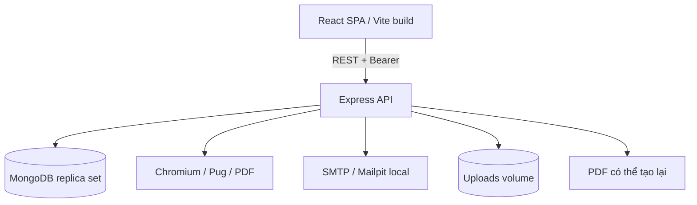
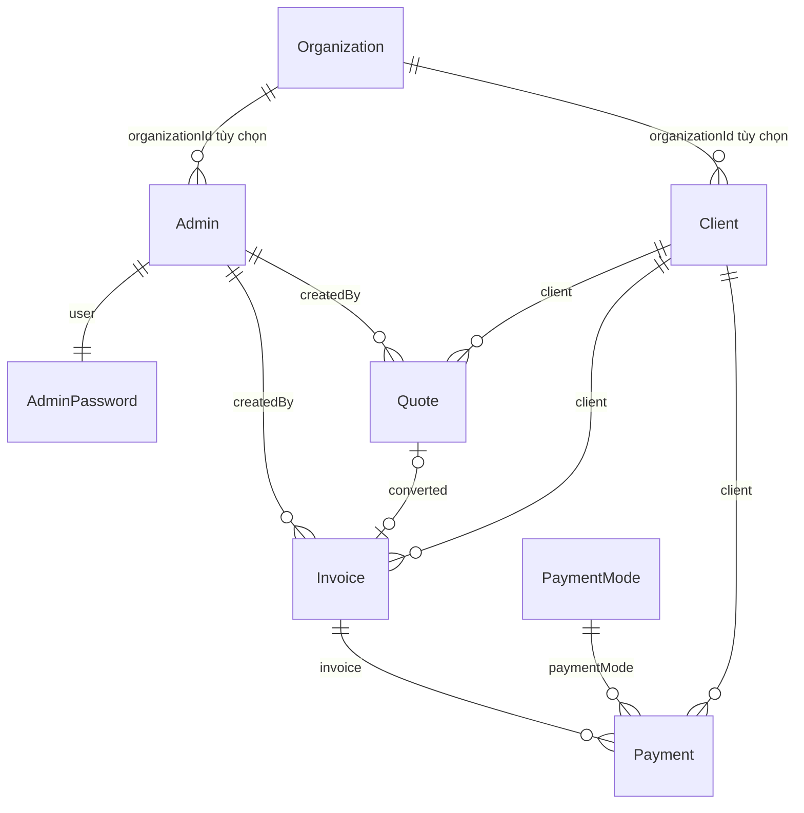

# Kiến trúc và dữ liệu

Đối tượng: lập trình viên, kiến trúc sư và reviewer.
Phụ trách: Maintainer kỹ thuật. Trạng thái: hiện trạng; mục tiêu SaaS được ghi riêng.
Phiên bản đối chiếu: `4.1.0`, baseline `d9187d0`. Rà soát: `2026-10-18`.

## Thành phần hiện có

Nginx phục vụ frontend production. Browser gọi backend theo URL được nhúng khi Vite build.
Backend nạp model, khởi động Express và kết nối MongoDB.
Single-node replica set local hỗ trợ transaction, không cung cấp high availability.
`/health` trả thành công từ Express mà không ping MongoDB hay SMTP.

## Mô hình dữ liệu

Sơ đồ biểu diễn quan hệ dự kiến; MongoDB không tự áp đặt foreign key hoặc ràng buộc một-một.
`Organization` có tên/slug; nhiều schema đã có `organizationId` nhưng field chưa bắt buộc.
`Taxes` lưu thuế suất để chọn; chứng từ chụp lại `taxRate` dạng số, không tham chiếu bản ghi thuế.
`Setting` lưu khóa/giá trị, gồm bộ đếm; tên model upload trong code là chuỗi `"Upload "` có dấu cách cuối.

`Invoice` và `Quote` nhúng các dòng hàng, tiền tệ, thuế, tổng và chiết khấu.
Hóa đơn giữ `payment[]` và `credit` để hiển thị; phiếu thu còn hiệu lực là nguồn tính lại số đã thu.
Mỗi phiếu thu tham chiếu hóa đơn, khách hàng, phương thức và người tạo.
`removed` là xóa mềm, không phải hệ thống audit trail bất biến.

Index số báo giá/hóa đơn gồm `organizationId, number, year`.
Index giúp tránh trùng số trong phạm vi đã thiết kế, không tự kiểm soát quyền truy cập.
Tham chiếu phải được kiểm tra cùng tenant trước khi phát hành SaaS.

## Luồng backend

Model trong `appModels` tạo danh sách entity/route.
Các entity là `client`, `quote`, `invoice`, `payment`, `taxes` và `paymentmode`.
Controller riêng thay hành vi CRUD chung cho tính tiền, chuyển đổi, gửi mail hoặc tổng hợp.

`coreModels/coreRoutes` quản lý tài khoản, mật khẩu, settings và file.
Route auth công khai được mount trước route có middleware xác thực.
Token hợp lệ cần cả JWT đúng và phiên nằm trong `AdminPassword.loggedSessions`.

Tạo hóa đơn và chuyển báo giá dùng transaction cho bộ đếm và chứng từ.
Tạo/sửa/xóa phiếu thu dùng transaction để tính lại credit và paymentStatus.
Không phải mọi thao tác ghi đều dùng transaction; xóa hóa đơn cập nhật phiếu thu ở thao tác riêng.

## Frontend

- `request/`: axios, token và xử lý phản hồi.
- `redux/` và `context/`: trạng thái dùng chung và theo module.
- `modules/`: ghép CRUD/ERP với chức năng từng loại chứng từ.
- `pages/` và `router/`: màn hình và điều hướng.
- `locale/`: bản dịch; `config/serverApiConfig.js` chọn URL backend.

Alias `@` trỏ đến `src` trong từng package.
Backend dùng CommonJS; frontend dùng ESM.
`ic_goz_crm` và tên package/repository là định danh lịch sử, không phải các sản phẩm riêng.

## Mục tiêu SaaS

Mọi request phải xác định tenant từ danh tính đã xác thực và kiểm tra phạm vi trên mọi truy vấn.
Settings, counters, tham chiếu, file và báo cáo đều phải đi theo phạm vi đó.
Đây là yêu cầu mục tiêu, chưa phải mô tả bảo đảm của bản hiện tại.
Không dùng một database chia sẻ chứa cả bản ghi có/không có tenant cho khách hàng thật khi chưa có migration.

## Nguồn đối chiếu

- [Server](../../backend/src/server.js), [Express](../../backend/src/app.js).
- [Models](../../backend/src/models), [loader](../../backend/src/models/utils/index.js).
- [App controllers](../../backend/src/controllers/appControllers).
- [Auth middleware](../../backend/src/controllers/middlewaresControllers/createAuthMiddleware/isValidAuthToken.js).
- [Compose](../../docker-compose.yml), [Vite](../../frontend/vite.config.mjs).
